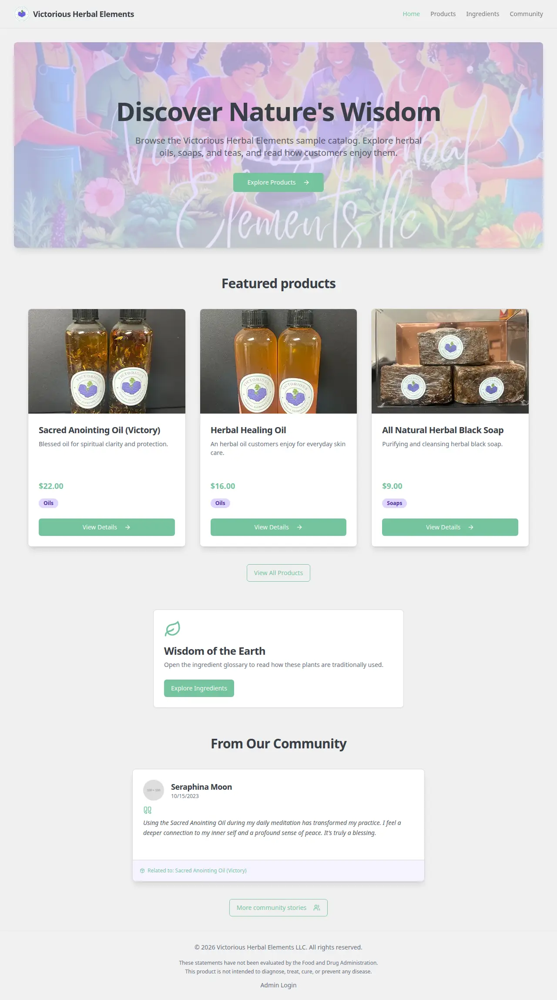
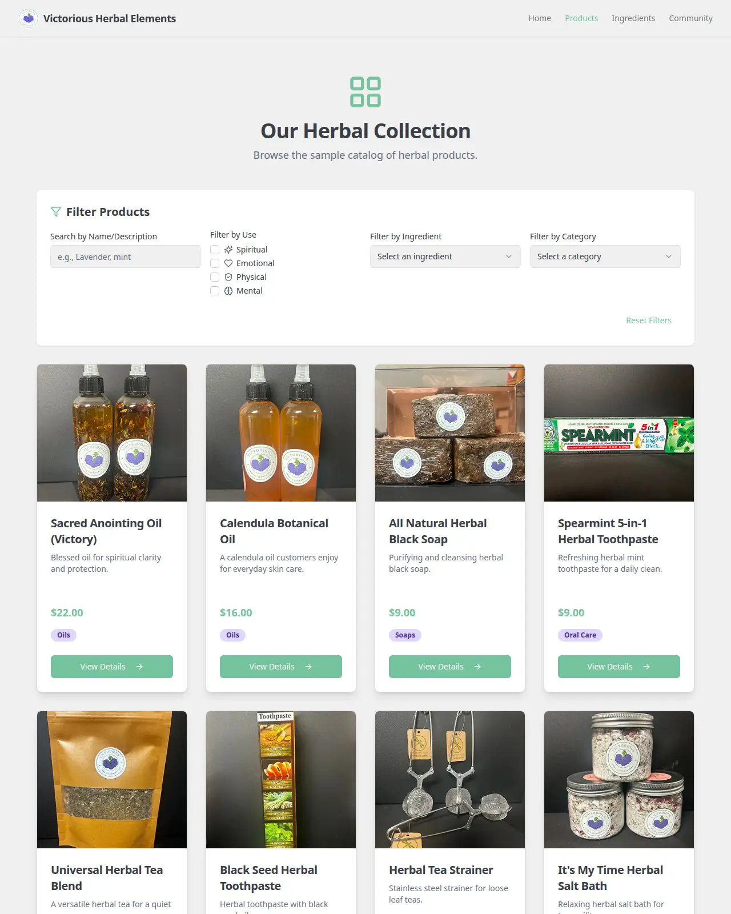
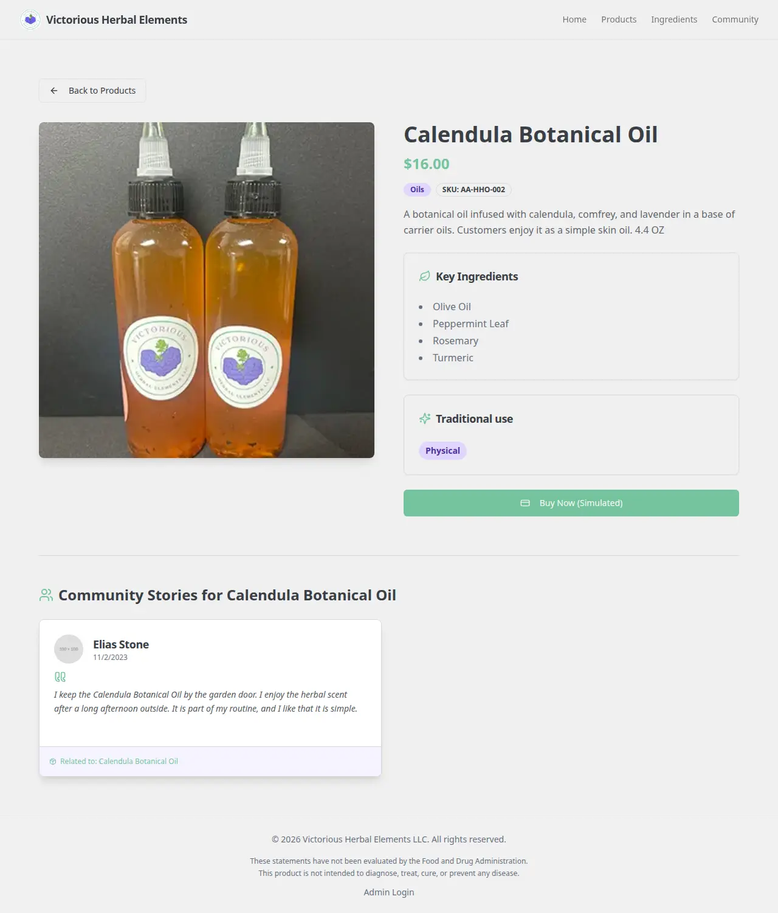
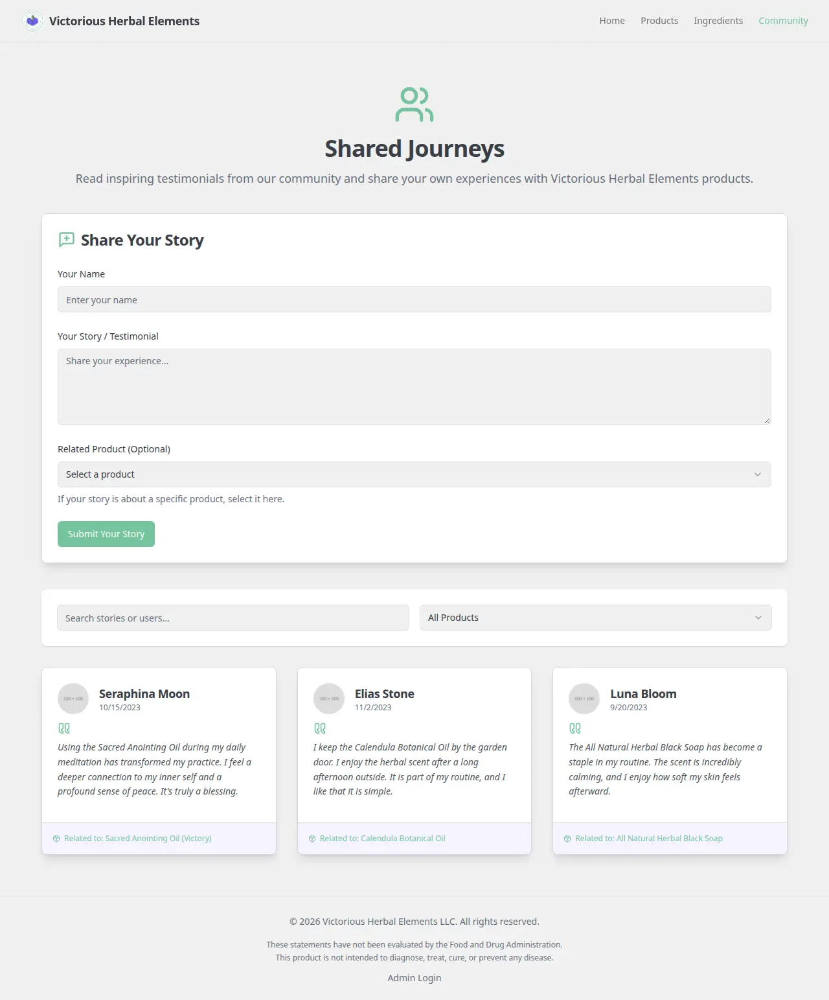

<p align="center">
  
</p>

# Victorious Herbal Elements

The Victorious Herbal Elements store, built by Andrew Strachan. Shoppers can browse a sample catalog, read an ingredient glossary, and add community stories that stay in the browser.

**Status:** Store with sample catalog data. Checkout is not open yet. No order is placed and no charge is made from the product page. Catalog edits last until the tab is closed.

Live: [herbal.nonartificialsi.com](https://herbal.nonartificialsi.com) · [aether-apothecary.web.app](https://aether-apothecary.web.app) · Part of [Andrew Strachan's portfolio](https://www.nonartificialsi.com)

## What it does today

- Shows the sample product catalog, with photos, prices, and categories, and filters it by category, ingredient text, and the tags stored on each product.
- Product pages list ingredients and related sample stories. **Buy Now** opens a notice that checkout is not open yet. No order is placed and no charge is made. The Stripe route stays in the repo for test mode later.
- The ingredient glossary and community page read `src/data`. Stories added on the community page stay in memory for the current visit.
- The public pages do not link to admin. The sample catalog lives in `src/data` for the current visit.
- Optional admin buttons call server actions that draft a description or images. Those calls need Google Cloud credentials on the server. No API key is shipped here, so the buttons stay offline until a host provides credentials.

## Planned

- Saving the catalog, stories, and orders in Firebase [planned]. `src/lib/firebase.ts` is a stub.
- Connecting **Buy Now** to the Stripe test-mode route, then to live payments when the owner turns that on [planned].
- A signed-in admin for the store [planned]. This branch does not turn on a public admin session.

## Screens

| Home | Products |
|---|---|
|  |  |

| Product | Community |
|---|---|
|  |  |

Captured from the local store with sample data. No real user data, keys, emails, or tokens appear in them.

## How it's built

- Next.js 15 (App Router), React 18, and TypeScript, styled with Tailwind. The shop's own colors in `src/app/globals.css` are soft lavender `#D0BFFF`, muted teal `#74C69D`, and light gray `#F0F0F0`.
- Sample products, ingredients, and stories live in `src/data` and are held in React context. A refresh restores the sample set.
- Stripe test configuration stays in server environment variables. It is not part of the browser bundle.
- Description and image flows use Genkit on the server (`src/ai`). They do not run unless the host has Google Cloud credentials.

## Run it locally

```sh
npm ci
cp .env.example .env.local   # fill in your own values; never commit them
npm run dev
```

The dev server listens on port 9002. Use Node.js 24 (`engines.node` is `24.x`). The catalog still builds when no environment variables are set.

Firebase Hosting for `aether-apothecary` is the host (no Cloud Functions). `npm run build:static` writes `out/`. That build has no server routes and does not load Stripe. Admin pages say "Admin is offline". A password is not required. `firebase.json` points hosting at `out/`.

## Tests and checks

```sh
npm run check
npm run build
gitleaks dir . --redact
```

`npm run check` runs the claims gate, the emoji gate, and the client-secret gate. This repo has no unit-test suite.

## Security

No secrets are committed. Configuration comes from environment variables listed in `.env.example`. Billable AI keys never reach the browser. Report a problem to strachan@uab.edu.

## Credits

The Victorious Herbal Elements store, built by Andrew Strachan.

## License

All rights reserved. Source shared for review.
